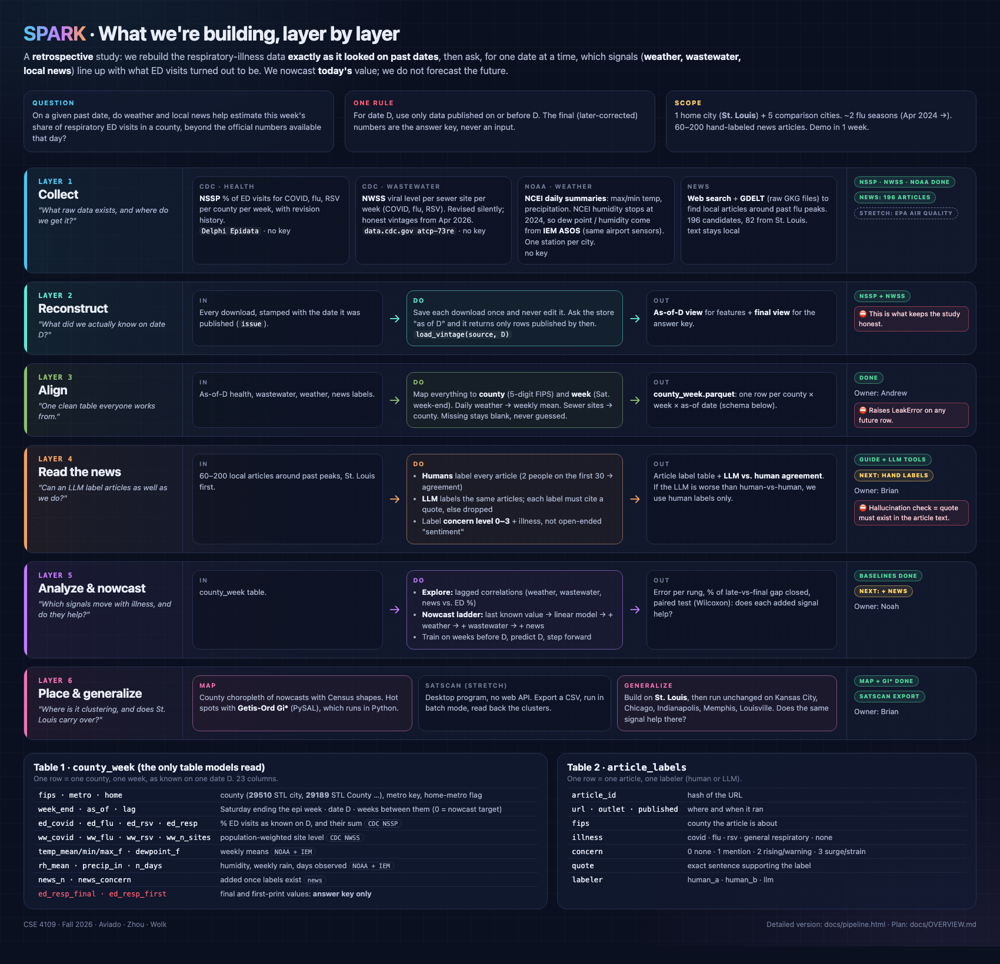
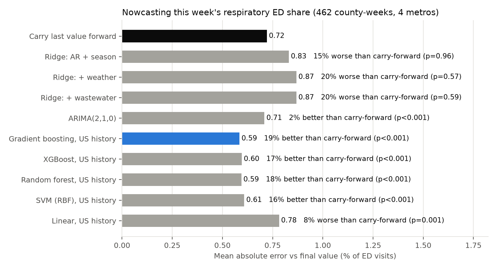

# Using Local Data to Nowcast and Track County-Level Outbreaks

Andrew Aviado · Brian Zhou · Noah Wolk
CSE 4109: Introduction to AI for Health, Fall 2026 · Washington University in St. Louis



Plan and hypotheses: [`docs/OVERVIEW.md`](docs/OVERVIEW.md) · detailed
pipeline: [`docs/pipeline.png`](docs/pipeline.png) · news labeling rules:
[`docs/LABELING_GUIDE.md`](docs/LABELING_GUIDE.md)

## The question

Emergency department (ED) visit counts and wastewater readings come out one to
two weeks late, and the early numbers keep changing for weeks after that. Local
news covers outbreaks sooner, but as plain text, not data.

This is a **retrospective** study. We rebuild every source exactly as it looked
on each past date, then ask: on that date, do weather, wastewater, and
LLM-labeled local news help estimate this week's share of respiratory ED
visits in a county, **beyond the official numbers public that day**? We
nowcast the current week; we do not forecast. A "no" is still a result.

St. Louis is the home metro; Kansas City, Chicago, Indianapolis, Memphis and
Louisville test whether the result carries over (`src/study.py`).

## What the data taught us (verified Oct 2026)

These shaped the design more than anything we planned.

1. **Official numbers get revised, a lot.** At the January 2026 flu peak, 19%
   of US counties' first published ED value was later revised by ≥10%, mostly
   upward. So every model trains and scores on a **vintage**: the data exactly
   as published on the prediction date.
2. **Missouri was invisible in real time.** NSSP published *nothing* for any
   Missouri county, including St. Louis and Kansas City, until June 2026,
   when two years of history appeared at once. For our home metro, the
   official number simply did not exist on most prediction dates.
3. **Missouri's 2024–25 history is not trustworthy.** In the back-filled data
   the January 2025 peak shows a median of 0.2% across all 115 Missouri
   counties, versus 7.8% in Chicago. That is incomplete facility reporting, not
   a mild season. Treat Missouri labels before ~Aug 2025 as suspect.
4. **St. Louis city and County are one series.** NSSP gives 29510 and 29189
   identical values in every signal; models count them once.
5. **Wastewater is revised too, invisibly.** CDC re-posts the whole NWSS history
   every Friday with one timestamp; in Aug 2026 it changed the method and
   rescaled history back to 2022 (31% of site-weeks changed category). Honest
   wastewater vintages exist only from **2026-04-17** (recovered from the
   Wayback Machine). Earlier weeks are available only as a labeled
   approximation (`allow_proxy=True`).
6. **NOAA stopped publishing humidity.** NCEI daily summaries have no dew point
   or humidity after 2024-12-31 at any study station. Humidity comes from the
   Iowa Environmental Mesonet copy of the same airport sensors (r = 0.999 with
   NCEI over 2024).
7. **`as_of` takes an epiweek, not a date.** `as_of=20260215` is silently read
   as a far-future week and returns the *latest* data. The ingester refuses it.

## Results so far (no news yet)

Rolling-origin backtest on the four metros with real-time data, 462
county-weeks from Jun 2024 to Aug 2026, scored against final values
(`python -m src.nowcast`, then `python -m src.figures` for `demo/fig_*.png`).
Skill = 1 − MAE / MAE of carrying the last value forward.



| Model | MAE | Skill | Wilcoxon vs carry-forward |
| --- | --- | --- | --- |
| Carry last value forward | 0.72 | – | – |
| Ridge: AR + season (+ weather, + wastewater) | 0.83–0.87 | −15% to −20% | n.s. |
| ARIMA(2,1,0) on the vintage series | 0.71 | +2% | p < 0.001 |
| Linear (ridge), US history, same features | 0.78 | −8% | worse, p = 0.001 |
| **Gradient boosting (HistGBM), US history** (`src/history.py`) | **0.59** | **+19%** | **p < 0.001** |
| Random forest, US history | 0.59 | +18% | p < 0.001 |
| XGBoost, US history | 0.60 | +17% | p < 0.001 |
| SVM (RBF, 10k-row sample), US history | 0.61 | +16% | p < 0.001 |

Every nonlinear model trained on the national history beats carry-forward;
a linear model on the same data and features loses. The four nonlinear
models are statistically tied (HistGBM vs RF p = 0.79, vs SVM p = 0.39, vs
XGBoost p = 0.046, which does not survive correction for multiple
comparisons). So the gain comes from the national history plus a nonlinear
fit, not from one particular algorithm. Settings were fixed in advance, not
tuned on the scored weeks.

The gradient-boosted model learns the week-to-week change from 675 Health
Service Areas' settled history (CDC `rdmq-nq56`, Oct 2022 →). On each date it
uses only weeks at least 8 weeks old, and no Missouri before June 2026. It
beats carry-forward in every metro (+12% Chicago, +17% Indianapolis, +25%
Louisville, +18% Memphis). That history is today's vintage, so an 8-week-old
week may still have moved slightly after the date (revision profile: under 2%
of values move >5% after 8 weeks). The ridge rungs learn from about 150
local examples, and they lose.

**News (first pass, LLM labels, not yet checked against humans).** A local
model (Qwen3 8B via Ollama, free; `python -m src.news.label`) labeled 224
articles; the quote check kept about 50 relevant articles tied to a study
county (Oct 2024 – Jan 2026). Adding news on top of the gradient-boosting
model plus the same local correction (rung 12 vs rung 11) lowers MAE from
0.61 to 0.56 (best overall, +22% vs carry-forward; paired Wilcoxon p = 0.036).
Read this as a lead, not a result:

- The whole gain comes from about four weeks at the Feb 2025 flu peak in
  Louisville and Memphis; over all other weeks news is slightly worse. It
  helps Louisville and Memphis, does nothing for Chicago, and hurts
  Indianapolis.
- The corpus was hand-picked around known peaks (`stratum = respiratory`),
  which favors news by construction. An honest test needs articles collected
  without knowing where the peaks were (e.g. every GDELT hit).
- On the 36 scored weeks that had news, the median change is about zero
  (p = 0.56); the mean gain is a few large peak-week corrections.
- LLM labels have no human agreement yet (`python -m src.news.agreement`).

**Ablation** (`data/results/metrics_ablation.csv`): without the season
harmonics the gain falls to +7%, and without momentum to +14%. Dropping the
study metros' own HSAs from training changes nothing (+19%, p = 0.58): the
dynamics transfer from the rest of the country. In the ridge model, weather
and wastewater add nothing.

**Where it fails:** it lags sharp peak onsets (Chicago Dec 2025, Louisville
Jan 2025; `demo/fig_timeline_*.png`). That is exactly where a faster signal
like news would have to help.

**No official data on the date** (Missouri before June 2026; held-out metros):
the season-only model is best (skill +0.35 vs the mean); weather is slightly
worse than season alone (p < 0.001).

## Ask the map (Demo II)

`python -m src.spatial.app` opens a page where you type a question ("where was
flu rising around St. Louis at Christmas 2025?") and get a county map, a short
written answer, each study metro's nowcast for that Saturday, and the local
news that was public that week. What keeps it honest:

- **The LLM only reads the question.** It fills a closed schema (illness,
  level or change, week, place); every number comes from the data. With no
  LLM running, a rule parser reads the question offline; the page says which.
- **Nothing is adjusted silently.** A date past the data, a missing week or an
  ambiguous county ("Jefferson County exists in 26 states") is stated in the answer.
- **Clusters are computed nationally, then cropped:** Gi* for levels, local
  Moran's I for week-over-week change. Tiny EDs (0% most weeks, 50% once) and
  CDC "Sparse" areas stay on the map but out of the lists and the cluster
  test; in the test lattice, two such cells hide a 16-county cluster.
- **News appears only once published**, with the quote that grounds its label.

What it shows for Sat Dec 27, 2025: St. Louis had **no** official number at
all (that week's first print appeared Jun 13, 2026), and Chicago's newest
official value, 3.2% for the week ending Dec 13, trailed that week's settled
11.9% nearly fourfold: the gap the nowcast has to close.

## Data

| Source | What it gives us | Module | Status |
| --- | --- | --- | --- |
| **CDC NSSP** via Delphi Epidata | **Target**: % of ED visits for COVID, flu, RSV; county, weekly, with revision history | `src/ingest_nssp.py`, `src/backfill_nssp.py` | ✅ 129 weekly vintages, Apr 2024 → |
| **CDC NWSS** wastewater (`atcp-73re`) | Weekly viral activity level per sewer site, mapped to county | `src/ingest_nwss.py`, `src/fips.py` | ✅ honest from 2026-04-17 |
| **NOAA NCEI** + **IEM ASOS** | Daily temp, precip (NCEI); dew point, humidity (IEM); one airport per metro, no key | `src/ingest_noaa.py` | ✅ 2024-01 → today |
| **Local news** (web search + GDELT GKG files) | 196 candidate articles, 173 with text; 82 St. Louis | `src/news/collect.py`, `src/news/fetch.py` | ✅ ready to hand-label |
| Census county shapes + population | Map, hot spots, SaTScan inputs | `src/spatial/shapes.py` | ✅ |
| EPA AirNow | PM2.5, ozone | – | Deferred |

## Pipeline

```
collect        ingest_nssp / backfill_nssp · ingest_nwss · ingest_noaa · news.collect → news.fetch
reconstruct    SnapshotStore.load_vintage(source, D)   ← the only door into features
label news     humans: labels/human_labels.csv   LLM: news.label → news.ground (quote check)
validate       news.agreement (Cohen's κ, LLM vs human)   news.baseline (VADER)
align          align → data/county_week.parquet   (raises LeakError on any future row)
model          nowcast → data/results/   (naive → AR+season → +weather → +wastewater → +news)
place          spatial.hotspots (Getis-Ord Gi*) · spatial.map · spatial.satscan (export)
```

### Running it

```bash
# weekly collection: run every week; a missed NWSS Friday is lost for good
python -m src.ingest_nssp                 # today's NSSP vintage, all counties
python -m src.ingest_nwss                 # today's wastewater vintage
python -m src.ingest_noaa                 # weather through yesterday

# one-time history
python -m src.backfill_nssp               # study-county vintages since 202416 (resumable)
python -m src.ingest_nwss --archive       # recover past NWSS vintages from the Wayback Machine

# news
python -m src.news.fetch                  # download text for labels/articles.csv → raw/news/
python -m src.news.label_app serve --labeler human_a   # hand labels in the browser → labels/human/
python -m src.news.label_app status       # progress, human-human overlap, disagreements
ollama pull qwen3:8b                      # free local LLM (or --backend anthropic)
python -m src.news.label && python -m src.news.ground
python -m src.align --news-source llm     # news_n / news_concern from LLM labels
python -m src.news.baseline && python -m src.news.agreement   # → data/labels/agreement_report.md

# table, models, map
python -m src.align && python -m src.nowcast
python -m src.spatial.map --week 2025-12-27 --out demo/map.html

# ask the map in plain English (Demo II); needs the CDC CSV in raw/cdc_nssp/
python -m src.spatial.app                 # browser: type a question, get map + answer
python -m src.spatial.query "where was flu rising around St. Louis at Christmas 2025?"
```

## Data collection protocol

1. **Run the weekly collection every week**, ideally Saturday. NSSP history
   can be rebuilt later; NWSS vintages cannot.
2. **Read the target only through a vintage.** `load_vintage(source, as_of)`
   for anything that trains or scores; `latest_vintage` only for plots and
   final labels.
3. **Snapshots are never edited.** A correction goes in under a new issue date.
4. **Data never goes in git.** `raw/` and `data/` are gitignored; share
   snapshots through Box. Article text stays local (copyright); only the URL
   catalog (`labels/articles.csv`) and our own labels are committed.
5. **Hand labels follow `docs/LABELING_GUIDE.md`.** Copy
   `labels/human_template.csv` to `labels/human_labels.csv`; two people label
   the same first 30 articles; hide the `stratum` column from labelers.

## Setup

```bash
git clone https://github.com/DoDaDrew18/CSE4109-SPARKProject.git
cd CSE4109-SPARKProject
python3 -m venv .venv && source .venv/bin/activate
pip install -r requirements.txt     # wheels only; no GDAL or compiler needed
python -m pytest tests/ -q          # expect 239 passed, all offline (macOS: brew install libomp)
```

Delphi limits anonymous use to ~60 requests/hour. A free key
(`--api-key`) makes the backfill and map fetches much faster.

## Layout

```
src/study.py           metros, counties, NOAA stations, week convention
src/snapshot.py        append-only snapshot store + vintage loader
src/ingest_nssp.py     NSSP target ingestion (today, or --as-of epiweek)
src/backfill_nssp.py   rebuild weekly NSSP vintages for the study counties
src/ingest_nwss.py     wastewater vintages + weekly county features
src/ingest_noaa.py     NCEI + IEM weather, weekly features with availability lag
src/fips.py            county name → FIPS (Census reference file)
src/align.py           county_week table with leak checks
src/nowcast.py         rolling-origin model ladder
src/evaluate.py        MAE, R², gap closed, skill, Wilcoxon
src/history.py         national HSA history → gradient-boosted weekly change
src/figures.py         demo figures from data/results/
src/news/              collect, fetch, label (LLM), label_app (humans), ground, agreement,
                       baseline, features
src/spatial/           shapes, hot spots (Gi*, local Moran), map, SaTScan export,
                       query + query_map + app (natural-language map, Demo II)
labels/                article catalog, labeling order, hand labels per labeler (committed)
docs/                  overview, schematic, pipeline chart, labeling guide
demo/                  St. Louis map views + screenshots
tests/                 pytest suite (offline; no network needed)
raw/, data/            snapshots, pulls, derived tables (gitignored)
```

## Team

| Member | Role | Owns |
| --- | --- | --- |
| Andrew Aviado | Data Lead | Ingestion, county/week alignment, vintage handling |
| Noah Wolk | ML Engineer | Baselines, nowcasting models, backtesting, ablations |
| Brian Zhou | Software Engineer | LLM extraction and validation, map, demo |

## Status

- [x] Snapshot store and vintage loader
- [x] NSSP ingestion + weekly vintage backfill for study counties
- [x] Study counties chosen (STL + 5 comparison metros)
- [x] NWSS wastewater ingestion (honest vintages from 2026-04-17)
- [x] NOAA/IEM weather ingestion
- [x] Aligned county-week table with leak checks
- [x] Baseline ladder + evaluation (naive, AR+season, weather, wastewater)
- [x] News candidate corpus (196 articles) + labeling guide
- [x] LLM labeler, quote-grounding check, agreement report (tested offline)
- [x] Map with Gi* hot spots; SaTScan input export
- [x] Hand-labeling app + fixed labeling order (`labels/assignments.csv`, 30 double-labeled)
- [ ] **Hand-label 60–200 articles** (two labelers on the first 30; `src/news/label_app.py`)
- [x] Run the LLM labeler (local Qwen3 8B via Ollama) + quote check
- [ ] Agreement report vs human labels
- [x] ARIMA, HistGBM, XGBoost, random forest, SVM, linear rungs; ablation
- [x] News rungs (4: ridge + news; 12: GBM + local + news), first pass on LLM labels
- [ ] News test on a corpus not picked around known peaks
- [ ] Decide how to treat Missouri labels before Aug 2025
- [x] Natural-language search on the map (Demo II; rule parser offline, LLM optional)
